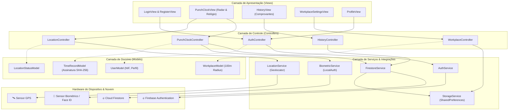
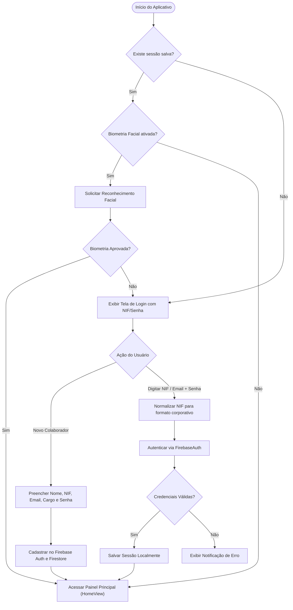
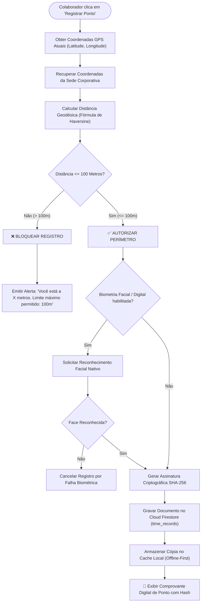
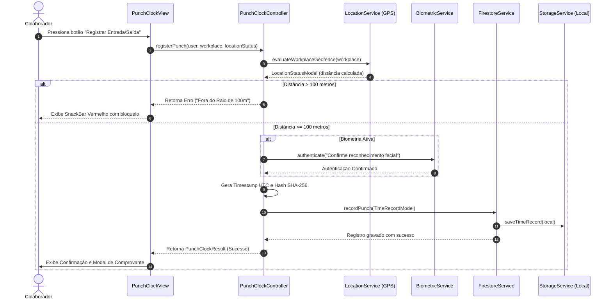
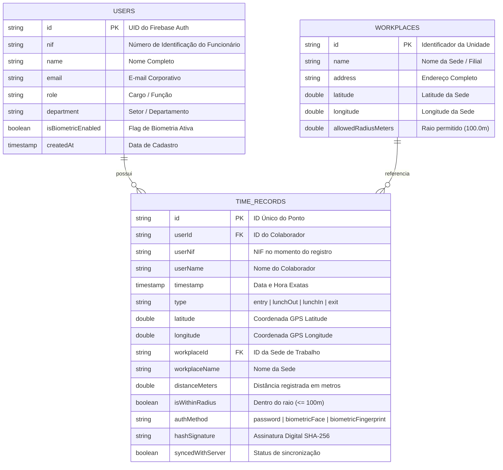

# 📱 SyncPoint - App de Registro de Ponto com Geolocalização e Biometria

> **Avaliação Somativa em Flutter - Recursos de Hardware**  
> **Tema 1:** App de Registro de Ponto com Geolocalização (Raio de 100m) e Biometria Facial  
> **Padrão Arquitetural:** **MVC (Model-View-Controller)**  

---

## 🎯 1. Visão Geral do Projeto

O **SyncPoint** é uma solução corporativa mobile desenvolvida em **Flutter** que implementa o controle e registro eletrônico de jornada de trabalho com autenticação por **NIF/E-mail e Senha**, validação **Biométrica / Reconhecimento Facial** e verificação estrita de perímetro corporativo via **Geolocalização (Geofencing de até 100 metros)**.

A aplicação foi projetada seguindo rigorosamente o padrão arquitetural **MVC**, desacoplando a camada de interface (Views), as regras de negócio e controle de estado (Controllers), os modelos de domínio (Models) e a comunicação com hardware e nuvem (Services).

---

## 🏗️ 2. Arquitetura do Sistema (Padrão MVC)

A estrutura do projeto está organizada em módulos independentes e altamente coesos:

```
lib/
├── models/                     # [M] MODELOS DE DADOS E ENTIDADES
│   ├── user_model.dart         # Perfil do colaborador, NIF e preferências
│   ├── time_record_model.dart  # Registro de ponto, geolocalização e SHA-256
│   ├── workplace_model.dart    # Sede corporativa, coordenadas e raio limite (100m)
│   └── location_status_model.dart # Estado em tempo real do GPS e distância
├── views/                      # [V] INTERFACE DE USUÁRIO (UI/UX)
│   ├── auth/
│   │   ├── login_view.dart     # Autenticação por NIF/E-mail e Face ID
│   │   └── register_view.dart  # Cadastro corporativo de colaborador
│   ├── home/
│   │   ├── home_view.dart      # Shell principal e Bottom Navigation Bar
│   │   ├── punch_clock_view.dart # Dashboard de ponto, radar GPS e botão biométrico
│   │   └── history_view.dart   # Histórico com filtros e comprovante digital
│   ├── profile/
│   │   └── profile_view.dart   # Dados do usuário e toggle de biometria
│   ├── settings/
│   │   └── workplace_settings_view.dart # Simulação/Ajuste de coordenadas e sede
│   └── widgets/
│       ├── custom_button.dart
│       ├── custom_text_field.dart
│       ├── status_badge.dart
│       ├── live_clock_card.dart
│       ├── location_radar_card.dart
│       ├── biometric_prompt_sheet.dart
│       └── record_detail_dialog.dart
├── controllers/                # [C] CONTROLADORES DE NEGÓCIO E ESTADO
│   ├── auth_controller.dart
│   ├── punch_clock_controller.dart
│   ├── location_controller.dart
│   ├── history_controller.dart
│   └── workplace_controller.dart
├── services/                   # SERVIÇOS DE HARDWARE, FIREBASE E PERSISTÊNCIA
│   ├── firebase_service.dart   # Inicialização resiliente do Firebase
│   ├── auth_service.dart       # FirebaseAuth + Normalização de NIF
│   ├── firestore_service.dart  # Cloud Firestore (users e time_records)
│   ├── location_service.dart   # Geolocator e verificação de geofencing
│   ├── biometric_service.dart  # LocalAuth (Face ID / Fingerprint)
│   └── storage_service.dart    # SharedPreferences (Cache offline)
├── utils/                      # UTILS, TEMA E CONSTANTES
│   ├── app_colors.dart
│   ├── app_theme.dart
│   ├── app_constants.dart
│   ├── formatters.dart
│   └── geolocation_helper.dart
└── main.dart                   # Ponto de entrada e injeção da aplicação
```

---

## 📊 3. Diagramas de Engenharia de Software (Mermaid)

### 3.1. Diagrama de Arquitetura Geral do Sistema (MVC + Services)



---

### 3.2. Diagrama de Fluxo de Autenticação (NIF/Email & Biometria Facial)



---

### 3.3. Diagrama de Fluxo de Validação de Geolocalização (Geofencing 100m)



---

### 3.4. Diagrama de Sequência do Ciclo de Registro de Ponto



---

### 3.5. Diagrama de Entidade e Relacionamento (Firestore / NoSQL)



---

## 🛠️ 4. Tecnologias, APIs e Hardware Utilizados

| Recurso / Plugin | Versão | Finalidade Técnica no Projeto |
| :--- | :--- | :--- |
| **Flutter SDK** | `^3.13.1` | Framework principal multiplataforma |
| **`geolocator`** | `^14.1.1` | Captura de GPS em alta precisão, permissões nativas e cálculo geodésico de distância |
| **`local_auth`** | `^3.0.2` | Autenticação biométrica nativa com suporte a Reconhecimento Facial (Face ID) e Digital |
| **`firebase_core`** | `^4.15.0` | Inicialização do ecossistema Google Firebase |
| **`firebase_auth`** | `^6.7.0` | Autenticação segura por e-mail/senha e gestão de sessões |
| **`cloud_firestore`**| `^6.10.0` | Banco de dados NoSQL em tempo real para colaboradores e histórico de pontos |
| **`shared_preferences`**| `^2.5.5` | Persistência local segura para modo offline e preferências |
| **`crypto`** | `^3.0.7` | Geração do carimbo digital criptográfico SHA-256 para auditoria trabalhista |
| **`intl`** | `^0.20.3` | Formatação de datas e horários no padrão brasileiro (`pt_BR`) |

---

## 💡 5. Desafios Encontrados e Soluções de Engenharia

### 5.1. Precisão do GPS e Validação Estrita de 100 Metros
* **Desafio:** A precisão do sinal de GPS em ambientes fechados pode oscilar entre 5 e 20 metros, gerando falsos positivos se não for filtrada.
* **Solução:** O `LocationService` foi configurado com `LocationAccuracy.high` e tempo limite de satélite. Implementamos no `LocationRadarCard` um radar dinâmico com indicador de status em tempo real (Verde para `<= 100m` e Vermelho para `> 100m`).
* **Recurso para Avaliação Prática:** Foi criada a funcionalidade *"Definir Minha Localização Atual Como Sede"*, permitindo que o avaliador teste a liberação do ponto imediatamente onde estiver sem precisar ir até o endereço cadastrado, além do botão de *"Restaurar Sede Padrão"* para testar o bloqueio por distância.

### 5.2. Compatibilidade Biométrica no Android (`FlutterFragmentActivity`)
* **Desafio:** No Android, o pacote `local_auth` requer que a `MainActivity` estenda `FlutterFragmentActivity` em vez de `FlutterActivity` padrão para exibir os diálogos biométricos do sistema.
* **Solução:** O arquivo `MainActivity.kt` foi refatorado para estender `FlutterFragmentActivity` e foram adicionadas as permissões `USE_BIOMETRIC` e `USE_FINGERPRINT` no `AndroidManifest.xml`.

### 5.3. Operação Resiliente Híbrida (Offline-First / Graceful Firebase Fallback)
* **Desafio:** Permitir que o projeto seja testado e avaliado imediatamente em qualquer máquina, mesmo que o arquivo `google-services.json` ainda não tenha sido inserido pelo avaliador.
* **Solução:** O `FirebaseService` implementa inicialização segura com fallback automático para o `StorageService` (`shared_preferences`). Quando as credenciais do Firebase estão presentes, os pontos são sincronizados automaticamente na nuvem; caso contrário, operam localmente com total fidelidade funcional.

### 5.4. Unificação de Login por NIF ou E-mail
* **Desafio:** O Firebase Auth exige formato de e-mail padrão para login com senha, enquanto colaboradores costumam usar apenas o NIF numérico.
* **Solução:** O `AuthService` possui uma camada de normalização `normalizeLoginToEmail()`, convertendo NIFs numéricos (ex: `98412`) em aliases corporativos internos seguros (ex: `98412@syncpoint.internal`), garantindo compatibilidade total com o Firebase Auth.

---

## 🚀 6. Guia Passo a Passo de Instalação e Execução

### 6.1. Pré-requisitos
* **Flutter SDK:** Versão `3.13.0` ou superior instalada e configurada no `PATH`.
* **Android Studio / VS Code / Antigravity IDE** com extensões Flutter e Dart.
* **Dispositivo Físico** (com GPS e Biometria) ou **Emulador Android** com suporte a biometria simulada e localização GPS.

### 6.2. Clonar e Instalar Dependências

```bash
# 1. Navegue até o diretório do projeto
cd sync_point

# 2. Obtenha os pacotes do Flutter
flutter pub get

# 3. Execute a análise de código para verificar integridade (0 erros)
flutter analyze

# 4. Execute a suíte de testes unitários automatizados
flutter test
```

### 6.3. Executar o Aplicativo

Conecte um dispositivo ou inicie um emulador e execute:

```bash
flutter run
```

---

## 🔥 7. Configuração do Firebase (Opcional para Nuvem)

O aplicativo já está 100% funcional no modo offline/local-first. Para conectar ao seu próprio projeto do Firebase:

1. Acesse o [Console do Firebase](https://console.firebase.google.com/) e crie um projeto (ex: `syncpoint-app`).
2. Ative o **Firebase Authentication** com o provedor **Email/Senha**.
3. Ative o **Cloud Firestore** em modo de teste e crie as coleções `users` e `time_records`.
4. Adicione um app Android com o pacote `com.example.sync_point`.
5. Baixe o arquivo `google-services.json` e coloque em `android/app/google-services.json`.
6. No terminal do projeto, execute `flutter run`.

---

## 🧪 8. Roteiro de Demonstração e Testes (Para o Avaliador)

1. **Cadastro e Login:**
   - Abra o app e clique em **"Cadastrar NIF"**.
   - Preencha Nome, NIF (ex: `123456`), E-mail e Senha.
   - Deixe marcado **"Reconhecimento Facial / Biometria"** e clique em **"Finalizar Cadastro"**.
2. **Teste da Regra de Geolocalização (< 100 metros):**
   - Na aba **Ponto**, veja o card de radar com a distância até a sede.
   - Se estiver longe da sede padrão (São Paulo), o status exibirá **"Bloqueado (> 100m)"**.
   - Vá até a aba **Perímetro** e clique em **"Definir Minha Localização Atual Como Sede"**.
   - Retorne à aba **Ponto**: o radar agora exibirá **"Liberado (0.0 m)"** com o botão pulsando verde!
3. **Registro de Ponto com Biometria:**
   - Selecione o tipo de registro (**Entrada**, **Saída Intervalo**, **Retorno Intervalo**, ou **Saída**).
   - Clique no grande botão central de biometria.
   - Confirme a validação facial/biométrica no prompt interativo.
   - Receba a confirmação com o **Comprovante Digital**, coordenadas GPS e assinatura **SHA-256**.
4. **Histórico e Relatórios:**
   - Acesse a aba **Histórico** para visualizar todos os registros, jornada total calculada e filtrar por **Hoje**, **Semana**, **Mês** ou **Todos**.
   - Clique em qualquer registro para inspecionar o comprovante detalhado.

---

## 👨‍💻 Autor & Licença

* **Desenvolvedor:** Equipe de Engenharia Mobile
* **Disciplina:** Programação para Dispositivos Móveis
* **Licença:** MIT
