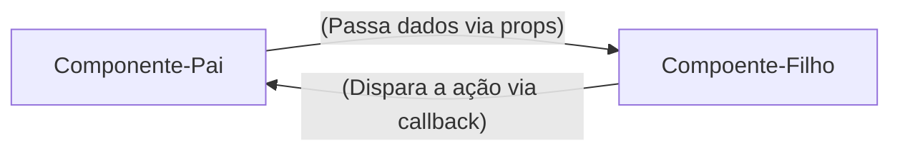
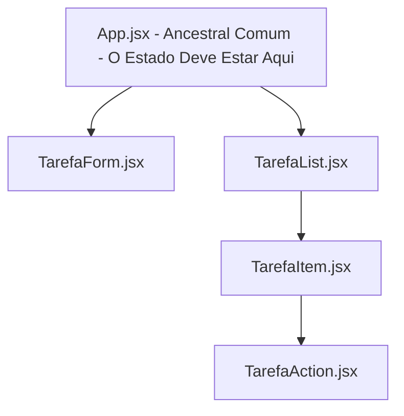

# Programação Front-End 2

## Angular

O framework Angular é uma plataforma para construção de aplicações web. Ele permite criar aplicações de página única (SPA) com uma arquitetura baseada em componentes, facilitando a manutenção e escalabilidade do código.

### História

O Angular foi desenvolvido pelo Google e lançado em 2010 como AngularJS. Em 2016, o Angular 2 foi lançado, trazendo uma reescrita completa do framework com foco em desempenho e modularidade. Desde então, o Angular tem evoluído continuamente, com versões regulares que introduzem novos recursos e melhorias.

O Angular utiliza TypeScript como linguagem principal, o que proporciona tipagem estática e recursos avançados de desenvolvimento. Ele também oferece um sistema de injeção de dependência, roteamento, formulários reativos e muito mais.

### Estrutura de um Projeto Angular

- `src/`: Diretório principal do código-fonte.
  - `app/`: Contém os componentes, serviços e módulos da aplicação.
  - `assets/`: Armazena arquivos estáticos como imagens e estilos.
  - `environments/`: Configurações de ambiente para desenvolvimento e produção.

### Componentes

Componentes são blocos reutilizáveis de código que encapsulam a lógica, o template e o estilo de uma parte da interface do usuário. Cada componente é definido por um arquivo TypeScript, um arquivo HTML e um arquivo CSS.

#### Exemplo de Componente

```typescript
import { Component } from '@angular/core';

@Component({
  selector: 'app-example',
  templateUrl: './example.component.html',
  styleUrls: ['./example.component.css']
})
export class ExampleComponent {
  // Lógica do componente
}
```

### Serviços

Serviços são classes que fornecem funcionalidades compartilhadas entre diferentes componentes. Eles são usados para gerenciar dados, fazer chamadas HTTP e encapsular lógica de negócios.

#### Exemplo de Serviço

```typescript
import { Injectable } from '@angular/core';

@Injectable({
  providedIn: 'root'
})
export class ExampleService {
  // Lógica do serviço
}
```

### Módulos

Módulos são contêineres que agrupam componentes, serviços e outros módulos relacionados. O módulo principal da aplicação é o `AppModule`, que é definido no arquivo `app.module.ts`.

#### Exemplo de Módulo

```typescript
import { NgModule } from '@angular/core';
import { BrowserModule } from '@angular/platform-browser';
import { AppComponent } from './app.component';

@NgModule({
  declarations: [
    AppComponent,
    // Outros componentes
  ],
  imports: [
    BrowserModule,
    // Outros módulos
  ],
  providers: [],
  bootstrap: [AppComponent]
})

export class AppModule { }
```

## React

O React é uma biblioteca JavaScript para construção de interfaces de usuário. Ele permite criar componentes reutilizáveis e gerenciar o estado da aplicação de forma eficiente.

### História

O React foi desenvolvido pelo Facebook e lançado em 2013. Ele introduziu o conceito de Virtual DOM, que melhora o desempenho da atualização da interface do usuário. O React é amplamente utilizado para construir aplicações web modernas e é conhecido por sua simplicidade e flexibilidade.

### Estrutura de um Projeto React

- `src/`: Diretório principal do código-fonte.
  - `components/`: Contém os componentes da aplicação.
  - `services/`: Armazena serviços e lógica de negócios.
  - `App.js`: Componente principal da aplicação.

### Componentes

Componentes no React são funções ou classes que retornam elementos JSX, que descrevem a interface do usuário. Eles podem receber propriedades (props) e gerenciar seu próprio estado.

#### Exemplo de Componente Funcional

```javascript
import React from 'react';

function ExampleComponent(props) {
  return (
    <div>
      <h1>{props.title}</h1>
      <p>{props.description}</p>
    </div>
  );
}
```

### Guia Rápido e Anotações

**Unidade Curricular:** Desenvolvimento Front-end
**Conteúdo:** Desenvolvimento com Framework - React

#### Semana 1 - Introdução ao React e Ambiente de Desenvolvimento

##### 1. O que é React 

Uma biblioteca Javascript (React.js) para criação de interfaces de usuário (UI)

Funciona de forma **declarativa**: Você descreve o resultado esperado com base nos dados, e o React atualiza o navegador

Cria *SPAs* (Single Page Applications): Atualiza partes da tela sem recarregar a página inteira.

##### 2. React vs Javascript Vanilla: Virtual DOM x Tradicional

O DOM no JS Vanilla é imperativo: Procura a tag, muda o componente e atualiza a página 

React(Declarativo): UI = Componente(dados) -> Quando os dados mudam, o React atualiza o componente.

##### 3. Comandos Essenciais no Terminal

```bash
# Criar projeto com Vite
npm create vite@latest <nome_projeto> -- --template react

# Atualizar e instalar dependências do projeto (node_modules)
npm install 

# Iniciar o servidor local (http:localhost:5173)
npm run dev
```

##### 4. Sintaxe do primeiro componente JSX(Javascript com Marcação HTML)

```jsx
  //src/App.js
  // COmponente raíz da aplicação
  function App() {
    const Sistema = "Meu Site";

    return (
      <main>
        <h1>{sistema}</h1>
        <p>Gerencie seus componentes em um só lugar</p>
      </main>
    );
  }

  export default App
```

> OBS.: O JSX exige **uma única tag raíz** (ou fragmento <> ... </>) e nome de componentes sempre começam com a letra maiúscula (UpperCamelCase)

#### Semana 2 - JSX, Components, Props e Events

##### 1. Responsabilidade Única (SOLID)

Quebrar a tela em componentes pequenos. Cada componente deve fazer apenas uma única coisa bem feita

**Exemplo de componentes**:
- `Header`: Cuida do título e do cabeçalho da aplicação
- `Footer`: Cuida do rodapé da aplicação 
- `NavBar`: Cuida da barra de navegação do site

> OBS.: O princípio do SOLID estabelece que uma unidade de software deve ter apenas um motivo para mudar

##### 2. Props: Passagem de dados e fluxo unidirecional

**O que são Props?** 

Os props são argumentos ou parâmetros das funções já que um componente React é uma função Javascript, ou seja, as props (abreviação de properties) permitem que o compoentne pai envie dados dinâmicamente para o componente filho, tornando-o customizável e reutilizável

##### 3. Eventos e Comunicação via Callbacks

React encapsulamento de eventos nativos em objetos, a diferença do react para o HTML é a sintaxe
- no HTML : `onclick="minhaFuncao()"`
- no React JSX : `onClick={minhaFuncao}`

> Funções em Javascript deve seguir o padrão lowerCamelCase de escrita.



##### 4. Listas Dinâmicas com map() e a propriedade `key`

**Por que arrays são estruturas padrão do front-end?**

Os dados chegam a partir DB e APIs no formato de coleção (JSON)

o método `.map()` percorre cada item de um array e retorna um novo componente JSX

Exemplo:

```jsx
tarefas.map((e) => (
    <TarefaItem
      key={e.id}
      id={e.id}
      titulo={e.titulo}
      descricao={e.descricao}
      concluido={e.concluido}
    />
))
```
**Por que o React exige o `key` no uso do .map()?**

O React precisa saber de forma inequívoca qual item específico foi adicionado, alterado ou removido quando renderiza uma lista. Se a chave for omitida, o react emite um aviso no console: `Warning: Each child in a list should have a unique "key" prop.`

> Evitar o índice do array como chave `(key={index})` : índice do vetor não é fixo, use sempre uma chave única para os itens da lista (carimbo de data e hora, id único)

##### Componentes de Formulário Estático

Criando o arquivo `TarefaForm.jsx`

#### Semana 3 - Estado Formulário e CRUD em Memoria

**Tema:** transição de uma interface estática para uma aplicação reativa, trablho com o hook fundamental `useState`, contrução de formulários com validação, Crud Completo, filtros e buscas textuais 

**Contextualização**: Na Semana 2, decomposição  de tela monolítica em componentes reutilizáveis, organização de fluxo dos props e captura de eventos

##### Bloco 1 - O Conceito de Estado e o hook `useState`

**Variável Comum vs. Estado Reativo**

```js
// variável comum do JS
function Contador(){
    let contador = 0;

    function incremento(){
        contador += 1;
        console.log("Contador no console", contador); // exibe o número
    }

    return (
        <div>
            <p>Clique: {contador}</p>
            <button type="button" onClick={incremento}>Somar<button>
        </div>
    )
}
```

Obs:
* JavaScript convencionais perdem suas variáveis locias o termino da execução
* O React não monitora variáveis comuns. Ele não sabe que a variável mudou e, portanto, não tem motivo para redesenhar a tela
* O estado (state) é a memoria do componente. Quando o estado é modificado por uma função, o React agenda ua nova execução da função do componente (re-renderização), atualizando o Virtual DOM e o navegador.

**A Sintaxe do `useState`**

ao invés do `let contador =0;`

Usa-se:

```jsx
const [contador, setContador] = useState(0);
```
Obs:
* `contador`: a foto do dado no momento da renderização atual;
* `setContador`: a função despachante que atualiza o dado e notifica o React;
* `useState(0)`: define o valor com o qual o componente nasce.

**Chamando a Mudnaça de Estado**

o próximo valor sempre depende do valor anterior 

```jsx
// Forma segura e profissional de realizar a mudança de estado 
setContador((prevContador) => prevContador + 1);
// atualização funcional do valor

//Outra forma - profissional
setContador(contador + 1);
```

> Fazendo a Mudança no Aplicativo de Lista de Tarefas
> React\lista-tarefas\src\App.jsx

##### Bloco 2 - Elevação de Estado (Lifting State Up)

A Comunicação entre os componentes, Para que dois ou mais componentes no React compartilhem ou modifiquem dados, o estado dever ser elevado para o ancestral comum entre eles.


Obs:
1. O Estado `tarefas`reside no App.jsx
2. O App.jsx cria as funções de modificação (handleAddTarefa, handleMudarTarefa, handleDeletarTarefa);
3. Os dados descem como props para quem precisa usá-los
4. As funções descem como callbacks para quem precisa disparar a ação;

##### Bloco 3 - Formulários Controlados e Validação

**Controlando Componentes (Controlled Components)**

No HTML tradicional, os inputs guardam seu próprio texto internamente no DOM. No React, a única fonte de aramazenamento deve ser o próprio React

Um input é controlado quando:
1. Seu atributo `value` está amarrado a um estado do React
2. Seu Evento `onChange` atualiza esse mesmo estado a cada caracter digitado

Exemplo de uso:
```jsx
const [titulo, setTitulo] = useState("");

<input
    type="text"
    value="titulo"
    onChange={(e) => setTitulo(e.target.value)}
/>
```

**Prevenindo o Recarregamento com `event.preventDefault()`**

evitar o comportamento nativo da web, que é subtemer fomrulários re recarregar a página quando formulário ou eventos forem enviados

```jsx
function handleSubmit(event){
    event.preventDefault(); //impede o carregamento da página
    //processamento dos dados
}
```

**Construir Fomrulário na Atividade Lista de Tarefas**
React\lista-tarefas\src\components\TarefaForm.jsx

---

##### Bloco 4 - Operações CRUD na Memória

**Imutabilidade no React**

Para que o React detecte uma alteração em um objeto ou array, devemos criar uma nova cópia com a alteração desejada.

Métodos como `.push()` `.unshift()` `pop()` não permitem modificar arrays no react, pois, o react compara o objeto na memoria e identifica que não teve mudança e conclui que não precisa fazer a renderização. a mudança só ocorre se form chamado o useState (mudança de estado)

**Operações de Imutabilidade no REACT**

* **Inserir**:

    `[novoItem, ...array]`
    // a mudança é feita criando um novo array com o novo item e espalhando os itens antigos

* **Remover**:

    `array.filter(item => item.id !== id)`
    // a mudança é feita criando um novo array filtrando os itens antigos e removendo o item desejado

* **Atualizar**:

    `array.map(item => item.id === id ? {...item, completed: true} : item)`
    // a mudança é feita criando um novo array mapeando os itens antigos e atualizando o item desejado
    

**Adicionando as 4 operações do CRUD no App.jsx**
React\lista-tarefas\src\App.jsx

---

##### Bloco 5 - Filtros e Buscas

**Erro de criar estados duplicados**

Muitos programadores pensam em duplicar listas no React, porém, isso é um erro. Se você apaga uma tarefa em uma lista  deve lembrar de apagar na outra também, se esquecer de fazer isso os dados ficam desincronizados e podem gerar problemas no código.

Para resolver esse problemas, se um dado pode ser calculado a partir de um estado já existente, usse esse calculo ou essa lógica. **Não crie um novo estado para ele, ou seja, não duplique!!!**

**Vamos Criar um Componente par filtragem das Tarefas em nossa aplicação.
Digite o Comando no Terminal
```bash
type nul > src/components/TarefaFilters.jsx
```

---

#### Semana 4 - O `UseEfect` e Seu Poder no Ciclo de Vida e na Persistência de Dados

**Tema:** Hook do `useEffect` , Dominar ciclo de vida dos componentes, Sincronização de dados e interfaces web inclusivas.

##### Bloco 1 - O que é hook `useEffect`e os Efeitos colaterais 

###### **função pura vs Efeito Colateral com `useEffect

Numa função em React um componente funcional deve ser uma função pura: recebe `props` e `state`, e retorna marcação `JSX`. Ou seja, as mesma entradas sempre devolvem a mesma saída, *sem modificar nada fora do seu escopo*.

Porém, aplicações reais precisam interagir com o mundo exterior (Efeitos Colaterais).

###### **A sintaxe do `useEffect`

O hook `useEffect` foi criado para abrigar efeitos colaterais de forma controlada e segura:

```jsx
import {useEffect} from "react";

useEffect(()=>{
    // 1. Código do efeito colateral (executado apos a renderização)

    return() => {
        //2. Função de Limpeza (opcional)
    };
}, 
[
    //3. Array de Dependências
]
);
```

**Ciclo do `useEffect`**:

1. Montagem da ação [Executa após a renderização do componente]

2. Atualização (Mudança de props e staes do componente)

3. Desmontagem (Efeito da ação vai sumir ou reiniciar)